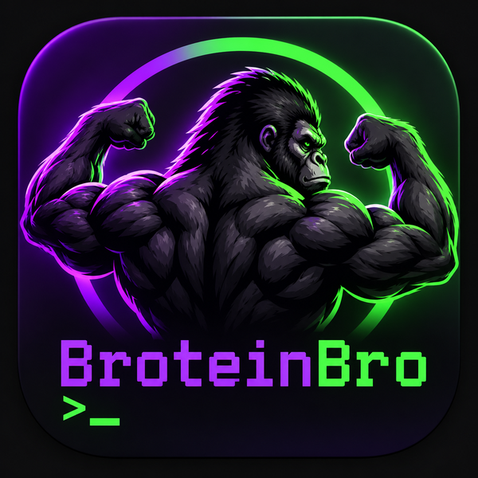

  

# BroteinBro

A simple Android protein tracker. Set a daily goal, tap photos of your foods to log protein, and see how many grams you have left. Green, purple, and black, with a gorilla.

## Features

- **Big goal display:** the number at the top shows how much protein you have left today (for example, `130g`). It turns green when you hit your goal and shows how far over you are if you go past it.
- **4x4 food grid:** 16 squares, each with your own photo, name, and protein amount.
- **Tap to add, double-tap to remove:** a single tap adds that food and lowers the total. A double tap removes one.
- **Counts on every square:** a badge shows how many of each food you've had today.
- **History (new in 1.1):** tap **History** in the lower right for a bar graph of the last 30 days. Purple bars are days under goal, green bars are days you hit it, and a dashed white line marks your goal. Touch or drag across the bars to see any day, plus your average, days goal met, and best day.
- **Your own foods:** open settings (gear icon, top right) to set your goal and edit any square. Tap an empty square to add a new food.
- **Saved on your phone:** goal, foods, photos, counts, and history are stored locally. Counts reset automatically each new day, and each day's total is kept for the History graph.

## Install

1. Go to the [Releases](../../releases) page and download `BroteinBro.apk`.
2. Open it on your Android phone. If Android asks, allow installs from your browser or files app.
3. Requires Android 8.0 (API 26) or newer.

Installing a newer version over an older one keeps your foods, photos, and settings, as long as both APKs were built on the same computer.

This is a debug-signed build for personal use, not a Play Store release.

## Build it yourself

You need [Android Studio](https://developer.android.com/studio). No Node or npm is required.

1. Clone or download this repo.
2. In Android Studio, choose **File > Open** and select the project's top-level folder.
3. Let Gradle sync finish. Accept the prompt to install Android SDK Platform 36 if it appears.
4. Choose **Build > Generate App Bundles or APKs > Generate APKs**.
5. The APK is at `app/build/outputs/apk/debug/app-debug.apk`.

You can also plug in a phone with USB debugging enabled and press the green Run button.

## How it works

BroteinBro is a native Android shell around a single web page.

- The whole app UI and logic is one file: `app/src/main/assets/index.html` (HTML, CSS, and JavaScript, no libraries).
- `MainActivity.java` hosts it in a `WebView` and handles the photo picker, confirm dialogs, and the Android back button.
- Data lives in the WebView's `localStorage`. Photos are cropped to squares and resized before saving. History keeps up to 120 days and the graph shows the latest 30.
- The launcher icon is an adaptive icon built from `logo.png`, in `app/src/main/res/drawable-nodpi/`.

To change the app, edit `index.html` and rebuild.

## Project details

| | |
|---|---|
| Version | 1.1 |
| Package | `com.broteinbro.app` |
| Min SDK | 26 |
| Compile SDK | 36 |
| Gradle / AGP | 8.14.3 / 8.13.0 |
| Language | Java (shell) + HTML/CSS/JS (app) |
